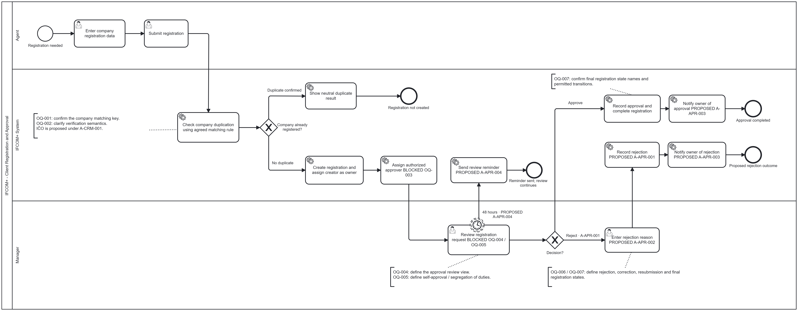

# InsuCorp (IFCOM+) — Insurance CRM Modernization

**Business and Systems Analysis portfolio case based on a real recruitment take-home assignment.**

The case explores a replacement for a legacy B2B insurance CRM used by a Czech distribution network. It covers requirements, business rules, access control, acceptance criteria, and the registration approval process.

**Current stage:** the BA documents, revised BPMN, and a draft registration lifecycle model are available. The lifecycle proposal is ready for review; the project epic and data, API, and SQL design are still to follow.

> This is an anonymized portfolio extension of a written recruitment brief. No stakeholder interviews or production implementation are claimed. Assumptions and unresolved decisions are identified throughout the documentation.

## Business Context and Scope

Some Agents could not access the legacy IFCOM application and sent paper forms to a home office for manual entry. The brief identifies delays, transcription errors, duplicate company registrations, and duplicate product sales or offers.

IFCOM+ covers company registrations, Manager approval, ownership and access rules, client products, organizational administration, and four management reports. The source termination rule is **one year after the client's last product is deactivated**.

See [Project Origin and Scope](docs/00-project-origin-and-scope.md) for the source context, constraints, and portfolio boundaries.

## Artifact Guide

| Artifact | What it contains |
|---|---|
| [00 — Project origin and scope](docs/00-project-origin-and-scope.md) | Source context, evidence boundaries, limitations, and extension scope |
| [01 — Requirements catalog](docs/01-requirements-catalog.md) | Functional requirements, non-functional requirements, constraints, and stable requirement IDs |
| [02 — User stories and BDD](docs/02-user-stories.md) | Eight stories with positive, negative, authorization, boundary, and concurrency scenarios |
| [03 — RBAC and business rules](docs/03-rbac-and-business-rules.md) | Role capabilities, record scope, access decisions, and business rules |
| [04 — Assumptions and open questions](docs/04-assumptions-open-questions.md) | Proposed extensions, unresolved decisions, priorities, and dependencies |
| [05 — Registration lifecycle (draft)](docs/05-registration-lifecycle.md) | Proposed states, transition table, closure rule, review scenarios, and open decisions |
| [BPMN source](diagrams/client-registration-approval.bpmn) | Editable BPMN 2.0 XML for Camunda Modeler |
| [BPMN preview](diagrams/client-registration-approval.png) | Image of the registration and approval process |
| [UML lifecycle source](diagrams/client-registration-lifecycle.puml) | Editable PlantUML state-machine draft |
| [UML lifecycle preview](diagrams/client-registration-lifecycle.png) | Draft registration states and product-related phases |

The `docs/` folder contains analysis documents. The `diagrams/` folder contains BPMN and UML sources and their previews. Edit the `.bpmn` file in Camunda Modeler and export its PNG after changes. For the lifecycle draft, edit the `.puml` source and regenerate the SVG and PNG with PlantUML.

## Client Registration and Approval

This model covers an Agent submitting a company registration, duplicate checking, initial ownership assignment, routing to a Manager, review, and the proposed outcome notifications. It has one pool and three lanes: **Agent**, **IFCOM+ System**, and **Manager**.

Read the diagram together with the [decision log](docs/04-assumptions-open-questions.md):

- **Company matching:** the duplicate-check key remains open under `OQ-001`; IČO is a proposal under `A-CRM-001`.
- **Approval policy:** `OQ-003`–`OQ-005` cover approver selection, the Manager's review access, and self-approval. The affected steps remain marked `BLOCKED`.
- **Proposed behavior:** rejection, a mandatory rejection reason, outcome notifications, and a 48-hour reminder are labeled `PROPOSED`. The reminder uses a non-interrupting boundary timer, so review continues.
- **Lifecycle boundary:** the one-year registration-termination rule is explored in the separate [draft lifecycle model](docs/05-registration-lifecycle.md). Its state names and transition choices remain proposals; `OQ-007` remains open.

The BPMN file is an analysis model marked `isExecutable="false"`. It documents behavior and decision gaps; workflow-engine implementation is outside the current scope.

## Evidence Boundaries

Artifacts distinguish `SOURCE` requirements, `DERIVED` rules, `ASSUMPTION` proposals, and unresolved `OPEN QUESTION` items. List visibility and detail access are modeled separately; Manager approval does not silently override owner-only access.

ARES integration, IČO checksum validation, REST endpoints, SQL design, and audit events are portfolio proposals. Inclusion in a document or diagram does not establish stakeholder approval.

## Project Progress

“Documented” means an artifact exists; it does not mean stakeholder approval.

| Stage | Current position |
|---|---|
| 1 — Origin and evidence boundaries | Documented in the origin file and README |
| 2 — Requirements catalog | Draft catalog available |
| 3 — Stories, access rules, and decision log | Draft documents available; project epic still to add |
| 4 — Process and lifecycle models | Revised BPMN and draft UML lifecycle available; lifecycle decisions still under review |
| 5 — Systems design | Domain model / ERD, data dictionary, OpenAPI, and SQL not yet added |
| 6 — Verification and traceability | BDD scenarios exist; consolidated test scenarios and traceability matrix still planned |
| 7 — Repository presentation | Artifact navigation updated; final consistency review remains |

## Next Work

1. **Review stage 4:** review the [draft lifecycle](docs/05-registration-lifecycle.md), especially product activation before approval, never-product registrations, the one-year boundary, and reactivation/reset behavior. Keep `OQ-006`, `OQ-007`, and `OQ-012` open until decisions are recorded.
2. **Add the project epic:** complete the remaining artifact requested in the original recruitment assignment.
3. **Build the systems-design artifacts:** domain model / ERD and data dictionary, followed by the proposed API contract and SQL schema and queries.
4. **Complete coverage and review:** consolidate test scenarios and connect requirements, rules, models, and tests in a traceability matrix.

The target evidence chain is:

`source brief → requirement → business rule/process → API/data constraint → test`

## Author and Contribution

**Oleksii Kim** — analysis of the written brief, requirements organization, user stories and acceptance criteria, access-policy analysis, process modeling, and documentation of assumptions and decision gaps.
