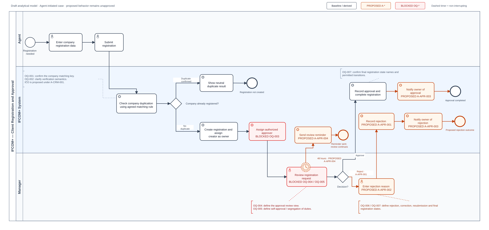

# InsuCorp (IFCOM+) — Insurance CRM Modernization

**Business and Systems Analysis portfolio case based on a recruitment take-home assignment.**

This repository develops a written brief into traceable requirements, user stories, authorization rules and process models for a proposed B2B insurance CRM. It focuses on explaining business behavior and exposing decisions that the source leaves unresolved.

> [!IMPORTANT]
> This is an anonymized portfolio and learning case. It does not represent a production implementation or client engagement. No stakeholder interviews were conducted. Independently proposed behavior is labeled as an assumption; unresolved policy is not presented as approved.

| Item | Description |
|---|---|
| Domain | B2B insurance and distribution-network CRM |
| Primary roles | Agent, Manager, Administrator |
| Author | Oleksii Kim |
| Current stage | BA documents and revised approval BPMN available as drafts; stage 4 remains open until the lifecycle model is added |
| Planned extensions | Domain model / ERD, OpenAPI, SQL and end-to-end traceability |

## Business Context

The legacy IFCOM application is slow, functionally limited and unavailable to some field agents. Paper forms and manual transcription create delays, errors, duplicate registrations and repeated product offers or sales.

The proposed IFCOM+ application covers company registrations, products, Manager approval, registration ownership, organizational structure, user administration and four management reports. Access depends on role and on record ownership, reporting relationships, organizational scope and delegation.

The source also requires registration termination one year after the client's last product is deactivated. This is a lifecycle rule, separate from initial registration approval. The brief states a Java/J2EE web application, Czech and Slovak localization, desktop/laptop/tablet support, continuous availability and approximately 20 registrations per day. Missing thresholds and ambiguous details remain open questions.

## Start Here

| Artifact | What it demonstrates |
|---|---|
| [00 — Project origin and scope](docs/00-project-origin-and-scope.md) | Source, evidence boundaries, portfolio extensions and limitations |
| [01 — Requirements catalog](docs/01-requirements-catalog.md) | 51 requirements/constraints, with assumptions and questions separated |
| [02 — User stories and BDD](docs/02-user-stories.md) | 8 stories and 45 acceptance scenarios, including negative and authorization cases |
| [03 — RBAC and business rules](docs/03-rbac-and-business-rules.md) | Role capabilities, record-scope policies and atomic business rules |
| [04 — Assumptions and open questions](docs/04-assumptions-open-questions.md) | 14 assumptions, 23 open questions and decision dependencies |
| [BPMN guide and revision history](diagrams/bpmn/README.md) | Process explanation, source-to-model mapping, previous changes and editing instructions |

Requirements and rules distinguish `SOURCE`, `DERIVED`, `ASSUMPTION` and `OPEN QUESTION`. The BPMN adds visible `PROPOSED A-*` and `BLOCKED OQ-*` labels. These are analysis statuses, not evidence of stakeholder approval.

## Featured Process: Client Registration and Approval

[Open SVG](diagrams/bpmn/client-registration-approval.svg) · [Open PNG](diagrams/bpmn/client-registration-approval.png) · [Edit Draw.io source](diagrams/bpmn/client-registration-approval.drawio) · [BPMN 2.0 representation](diagrams/bpmn/client-registration-approval.bpmn)

The diagram shows the Agent-initiated case in one pool with three lanes: Agent, IFCOM+ System and Manager. It covers submission, duplicate checking, record creation with initial ownership, approver assignment, Manager review and recorded outcomes.

Rejection, rejection reasons, owner notifications and the 48-hour reminder remain proposals under `A-APR-001`–`A-APR-004`. The timer is non-interrupting: it sends a reminder while review continues. IČO remains a proposed company key. Registration state names remain open.

The `.bpmn` file is the primary editing source for Camunda Modeler and remains non-executable. The `.drawio` file is a secondary copy for diagrams.net; it does not synchronize automatically. Both previews show the same reviewed model. See the [guide](diagrams/bpmn/README.md) for scope boundaries and maintenance instructions.

## Key Findings

- **List visibility differs from detail access.** An authorized registration summary does not automatically permit opening or editing the record.
- **Approval needs a defined access exception.** The source requires Manager approval while restricting detail access to the owner. `OQ-004` captures the unresolved review view.
- **Approver selection and self-approval are unresolved.** `OQ-003` and `OQ-005` must be addressed before implementation rules are consistent.
- **Role alone does not determine access.** Ownership, reporting relationships, organizational scope and deputy delegation also matter.
- **Lifecycle needs its own model.** The one-year termination rule is distinct from approval and depends on product history and time.

## Work Completed and Next Steps

| Area | Status |
|---|---|
| Project origin and documentation navigation | Available |
| Requirements, stories, RBAC and decision log | Draft artifacts available; open questions remain |
| Registration and approval BPMN | Revised draft with synchronized visual/semantic representations and previews |
| Registration lifecycle/state model | Next artifact; stage 4 is not yet complete |
| Domain model / ERD, OpenAPI and SQL | Planned |
| Separate system tests and traceability matrix | Planned; written BDD scenarios already exist |

The next modeling task is to document explicit portfolio choices for unresolved approval behavior and build the registration lifecycle/state model. After that, add the domain/ERD model, selected OpenAPI operations, SQL constraints and queries, and source-to-test traceability.

The intended evidence chain is:

`source brief → requirement → business rule / process → data / API constraint → test evidence`
