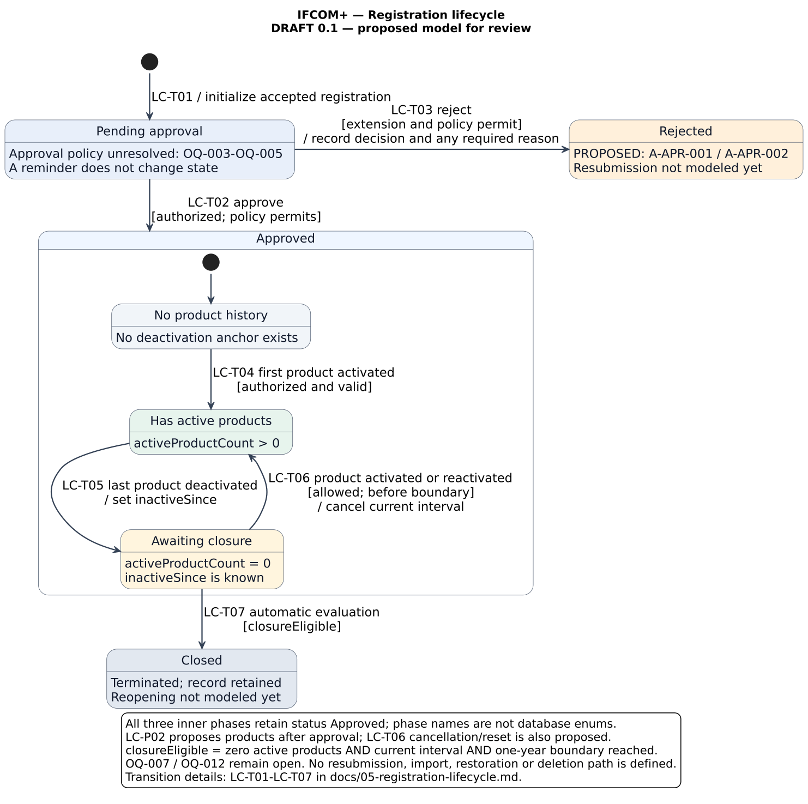

# IFCOM+ Registration Lifecycle

## 1. Status and Reading Guide

| Field | Value |
|---|---|
| Version | 1.0 — 18 October 2026 |
| Status | **Portfolio model — assumptions and open decisions are explicitly recorded** |
| Modeled object | One newly created company registration |
| Author | Oleksii Kim |
| Evidence boundary | [Project Origin and Scope](00-project-origin-and-scope.md) |
| Requirements | [Requirements Catalog](01-requirements-catalog.md) |
| Acceptance criteria | [User Stories and BDD](02-user-stories.md), especially `US-APR-001`, `US-PROD-001`, and `US-LIFE-001` |
| Policies and rules | [RBAC and Business Rules](03-rbac-and-business-rules.md) |
| Decisions | [Assumptions and Open Questions](04-assumptions-open-questions.md) |

This document proposes states and transitions for discussion. It does not answer the existing open questions or promote assumptions into approved requirements. `LC-P*` and `LC-T*` are local proposal and transition IDs in this document; they do not replace the catalog's `A-*`, `OQ-*`, or `BR-*` IDs.

Start with the diagram, then read the state definitions and transition table. Sections 7–9 identify the decisions needed before the model could support an implementation.

## 2. UML State Machine



[Editable PlantUML source](../diagrams/client-registration-lifecycle.puml) · [Scalable SVG](../diagrams/client-registration-lifecycle.svg) · [PNG preview](../diagrams/client-registration-lifecycle.png)

The rounded rectangles are states; labels inside `[...]` are transition conditions, and text after `/` describes an effect. The outer **Approved** rectangle is a composite state: its three inner phases all retain approval status `Approved`. The phases describe the registration in relation to the client's products; they are not separate product objects or prescribed database enum values.

All arrows are candidate behavior for review. A solid line is UML notation, not evidence of stakeholder approval. The initial transition initializes a registration whose creation has already been accepted; it does not approve the company matching rule. The notation follows [PlantUML's state-diagram syntax](https://plantuml.com/state-diagram).

### Scope

- Entry occurs after an authorized creation request passes the agreed validation and duplicate checks and the registration is persisted with one owner.
- Form editing before persistence, imports, migration, cancellation, deletion, and restoration are outside this version.
- The existing [BPMN](../diagrams/client-registration-approval.bpmn) shows the Agent-initiated workflow. This lifecycle belongs to the registration object, regardless of whether the authorized creator is an Agent or a Manager.
- The model is an analysis artifact. It does not prescribe database storage, a workflow engine, or a scheduler.

## 3. Evidence and Local Proposals

### 3.1 Source and Baseline Rules

| Reference | What the existing baseline establishes |
|---|---|
| `FR-CRM-007`, `BR-CRM-006`, `BR-CRM-007` | A registration has exactly one current owner; its creator is the initial owner. |
| `FR-APR-001`, `BR-APR-001` | A newly submitted registration requires Manager approval before completion of registration. |
| `FR-PROD-002`, `BR-PROD-004` | Product deactivation has an effective date. |
| `FR-LIFE-001`, `BR-LIFE-001`–`BR-LIFE-004` | Registration termination is automatic one year after the last product is deactivated, provided no active product remains; the last-product event anchors the boundary. |
| `BR-LIFE-005` | If reactivation is supported, an active product removes termination eligibility. Reactivation policy remains provisional. |
| `OQ-007`, `OQ-012` | State names, transitions, the meaning of one year, time zone, and reactivation behavior are unresolved. |

The source does **not** define a timeout starting from registration creation or Manager submission. A 48-hour review reminder is a separate proposal under `A-APR-004`.

### 3.2 Local Proposals in This Model

All entries below have status **PROPOSED**. They are alternatives to review, not new approved business rules.

| ID | Model choice | Dependency and consequence |
|---|---|---|
| `LC-P01` | Use `Pending approval`, `Approved`, `Rejected`, and `Closed`, with three product-related phases inside `Approved`. | `OQ-007`. Names and persistence representation can change. “Approved” avoids confusing registration approval with product activity. |
| `LC-P02` | In the illustrated path, a new registration has no products at approval, and activation of a client-product relationship starts only after approval. | `OQ-007`, `FR-PROD-001`. **The source does not impose this ordering.** If products can exist before approval, the entry logic and coverage of pending/rejected registrations must be redesigned. |
| `LC-P03` | Do not invent an automatic closure deadline for a registration that has never had a product. | `OQ-007`, `OQ-012`. No last-product deactivation anchor exists. This is not an approved indefinite-retention policy. |
| `LC-P04` | A permitted activation or reactivation before the closure boundary cancels the current inactivity interval; a later last-product deactivation starts a new interval. | `BR-LIFE-005`, `OQ-012`. Removing eligibility while a product is active is already provisional baseline behavior; the cancellation/reset mechanism is this model's proposal. |
| `LC-P05` | Show rejection if `A-APR-001` is adopted; require a reason only if `A-APR-002` is adopted. | `OQ-006`. Reason capture in the diagram is conditional on the chosen extension. |

Correction/resubmission after rejection and reopening after closure are deliberately **not modeled yet**. Their omission is an unresolved decision, not a permanent prohibition. Neither `Rejected` nor `Closed` is drawn as a UML final pseudostate, and neither implies physical deletion.

## 4. State Definitions

| State / phase | Meaning and invariant | Boundary |
|---|---|---|
| `Pending approval` | The registration exists and awaits a valid Manager decision. Ownership remains defined. | Does not determine who may review or approve; `OQ-003`–`OQ-005` still block the policy. |
| `Rejected` | A rejection decision has been recorded under the proposed extension. | Correction rights, resubmission, a new approval attempt, and retention are unresolved. |
| `Approved` | A valid approval decision has completed the registration workflow. Exactly one inner phase is active in this model. | Approval alone does not establish that a client product is active. |
| `Approved / No product history` | The client has not yet had a product in the modeled lifecycle. No inactivity anchor or closure deadline exists. | Initial approved phase under `LC-P02`; never-product handling remains open. |
| `Approved / Has active products` | At least one client-product relationship is active. The registration is not eligible for termination. | Adding another product or deactivating only some products does not leave this phase. |
| `Approved / Awaiting closure` | Products existed, the last active product was deactivated, no active product remains, and the inactivity anchor is known. | Approval is retained during the waiting interval. Closure cannot occur before the agreed one-year boundary. |
| `Closed` | Automatic termination has occurred under `FR-LIFE-001`; the record still exists. | Reopening, further product actions, editing, and retention require explicit policy. Existing authorization rules still apply to access. |

An ownership reassignment does not by itself change lifecycle state. A notification, reminder, failed operation, or denied access attempt also does not change state.

## 5. Transition Table

Every transition also requires applicable authorization and business validations. `policy permits` is an unresolved predicate where noted; it is not an implemented authorization function.

| ID | From → To | Event / condition | Effect | Evidence and readiness |
|---|---|---|---|---|
| `LC-T01` | Initial → `Pending approval` | Enter the lifecycle after accepted, nonduplicate registration creation. This is initialization, not a trigger on the UML initial arrow. | Retain the assigned owner and initialize the pending state. | `FR-CRM-001`, `FR-CRM-006`, `FR-CRM-007`, `FR-RBAC-008`, `LC-P01`. Matching still depends on `OQ-001`. |
| `LC-T02` | `Pending approval` → `Approved / No product history` | Manager approves; approver, review access, and self-approval policy permit it; the current approval step has no final decision. | Record the approval once and enter the initial approved phase. | `FR-APR-001`, `BR-APR-001`, `BR-APR-002`, `LC-P01`, `LC-P02`. **BLOCKED** by `OQ-003`–`OQ-005`; state design remains `OQ-007`. |
| `LC-T03` | `Pending approval` → `Rejected` | Authorized rejection, if adopted; no final decision already exists; required reason is present if that rule is adopted. | Record one rejection decision and any required reason. | `A-APR-001`, `A-APR-002`, `BR-APR-002`–`BR-APR-004`, `LC-P05`. **PROPOSED**; `OQ-003`–`OQ-007`. |
| `LC-T04` | `Approved / No product history` → `Approved / Has active products` | An authorized, valid first client-product relationship becomes active. | Reflect the active product; no closure interval is running. | `FR-PROD-001`, `FR-PROD-003`, `LC-P02`; state and product semantics need refinement. |
| `LC-T05` | `Approved / Has active products` → `Approved / Awaiting closure` | A deactivation becomes effective and leaves zero active products. | Record the effective inactivity start and derive the boundary using the agreed rule. | `FR-PROD-002`, `FR-LIFE-001`, `BR-PROD-004`, `BR-LIFE-001`–`BR-LIFE-004`. Date semantics depend on `OQ-012`. |
| `LC-T06` | `Approved / Awaiting closure` → `Approved / Has active products` | Before the boundary, a new product becomes active or an existing product is reactivated, if that operation is permitted. | Remove termination eligibility and cancel the current closure interval. | `BR-LIFE-005`, `LC-P04`, `OQ-012`. **PROPOSED** cancellation/reset behavior; reactivation is not assumed to be a source-required feature. |
| `LC-T07` | `Approved / Awaiting closure` → `Closed` | Automatic evaluation finds zero active products, a known current inactivity interval, and an agreed boundary that has been reached. | Terminate the registration once and invalidate work for that interval. | Source outcome: `FR-LIFE-001`, `BR-LIFE-001`–`BR-LIFE-004`. State names and execution details remain open. A scheduler is only `A-LIFE-001`. |

The unlabeled initial transition inside `Approved` selects `No product history` under `LC-P02`; it is part of `LC-T02`, not an additional business event.

### Events That Keep the Current State

- A 48-hour review reminder, if adopted, leaves `Pending approval` unchanged.
- Recording another active product or deactivating a non-last product leaves `Has active products` unchanged.
- Ownership reassignment, permitted detail editing, and notifications do not automatically approve, reject, or close a registration.
- Repeated decisions, invalid product operations, and stale closure evaluations do not create an extra transition.
- A duplicate company detected before persistence never enters this registration's lifecycle.

## 6. Closure Eligibility and the Inactivity Interval

The following names are conceptual analysis terms, not a database schema:

| Term | Meaning |
|---|---|
| `activeProductCount` | Count of currently active client-product relationships under the agreed effective-date rule. |
| `inactiveSince` | Effective timestamp of the deactivation event that left the client with no active product in the **current** inactivity interval. |
| `closureDueAt` | Boundary derived from `inactiveSince` using the agreed one-year rule and time zone. |
| `intervalIsCurrent` | Any closure work still refers to the same interval; a cancelled or superseded interval cannot close the registration. |

A proposed evaluation predicate for `LC-T07` is:

```text
state = Approved / Awaiting closure
AND activeProductCount = 0
AND inactiveSince is known
AND intervalIsCurrent
AND evaluationTime >= oneYearBoundary(inactiveSince, agreedCalendarRule, agreedTimeZone)
```

The source requires the automatic business outcome. The formula makes the checks visible; its state restriction follows `LC-P02`, and its execution mechanism remains open.

- Do not substitute registration creation, approval time, or database update time for the last-product effective deactivation event.
- Do not silently define one year as 365 days, 366 days, or 12 months. Leap-day handling and time zone are part of `OQ-012`.
- No product history means no deactivation anchor. An approved registration with zero products is not sufficient by itself to start a countdown.
- A permitted activation before the boundary removes eligibility while any product is active. Under `LC-P04`, a later last-product deactivation creates a new interval.
- Recheck the state, interval, and active products when applying closure. A previously calculated deadline alone is insufficient.
- A delayed evaluation still uses the original effective anchor. Scheduler frequency, allowed delay, failures, retries, and ownership are not defined by this model.
- At the exact boundary, or after the boundary but before delayed processing, the ordering of activation and closure is unresolved. A concurrency rule is needed; do not claim the diagram settles this race.

If imported data, products before approval, future-effective changes, or retroactive date corrections are allowed, this model needs additional entry/reconciliation paths.

## 7. Authorization and Consistency

This lifecycle supplements [the existing policy model](03-rbac-and-business-rules.md). State eligibility never grants role or record access.

- Approval still depends on `POL-APR-001`–`POL-APR-004`. Manager review access and self-approval remain blocked decisions.
- Rejection depends on `POL-APR-005` and `POL-APR-006` and the selected rejection extensions.
- Product transitions require authorization, valid product semantics, and duplicate checks. This model does not resolve product-operation permissions merely by entering `Approved`.
- `BR-APR-002` allows at most one final decision per approval step. Any future resubmission design must define a new attempt or another explicit policy, rather than overwrite that decision.
- Closure must not succeed while a product is active. Stale or repeated work should have no additional effect. Atomic checks, versioning, and idempotency are design topics for the later API/SQL stage.
- Closure does not delete the registration or establish unrestricted historical access.

## 8. Review Scenarios

These are model walkthroughs, not executed software tests. They supplement the BDD in `US-LIFE-001`.

| ID | Situation | Expected model behavior / unresolved point |
|---|---|---|
| `LC-C01` | Duplicate company found before persistence | No new registration lifecycle is initialized. |
| `LC-C02` | Registration created; no Manager decision | Remains `Pending approval`; a proposed reminder does not close it. |
| `LC-C03` | Authorized approval under a defined policy | Enters `Approved / No product history` under `LC-P02`. |
| `LC-C04` | Approved registration never had a product | No invented one-year countdown. Separate expiry policy remains open. |
| `LC-C05` | Two active products; only one deactivated | Remains `Has active products`; no closure interval starts. |
| `LC-C06` | Last active product deactivated; boundary not reached | Enters/remains `Awaiting closure`; registration is not closed early. |
| `LC-C07` | Current interval reaches its agreed boundary; no active products | Automatic closure applies once. |
| `LC-C08` | Allowed activation/reactivation before the boundary | Returns to `Has active products`; old closure work must not apply. |
| `LC-C09` | Last product deactivated again after `LC-C08` | Starts a new interval using the new effective event under `LC-P04`. |
| `LC-C10` | Duplicate, stale, or already completed closure evaluation | Does not apply an extra transition or close a reactivated registration. |
| `LC-C11` | Activation races with closure at the boundary | Policy and atomic ordering remain open; never close based only on a stale count. |
| `LC-C12` | Rejected submission needs correction; closed registration needs restoration | No invented transition. Resolve `OQ-006`/`OQ-007` before adding one. |

Concrete leap-year dates, time-zone examples, and concurrency tests must follow the decision on `OQ-012`; this model does not select them implicitly.

## 9. Review Decisions Before Baselining

| Review question | Existing decision reference | Model impact |
|---|---|---|
| Who approves, what may they inspect, and may they approve their own registration? | `OQ-003`–`OQ-005` | Defines the guards on approval and proposed rejection. |
| Is rejection needed? Who may correct/resubmit, and how is a new approval attempt recorded? | `OQ-006`, `OQ-007` | Determines rejection and any return path. |
| Are the four status names and three inner phases useful? Are phases derived or persisted? | `OQ-007` | Determines the final state vocabulary and representation. |
| May products be recorded or activated before approval? | `OQ-007`, refinement of `FR-PROD-001` | Accepts or replaces `LC-P02`; may require lifecycle coverage outside `Approved`. |
| What happens to a registration that never had a product? | `OQ-007`, `OQ-012` | Confirms or replaces `LC-P03`. |
| What is one year, which time zone applies, and how are effective dates corrected? | `OQ-012` | Determines the closure boundary. |
| Which activation/reactivation operations are allowed before, at, or after the boundary? Does a new inactivity interval reset the clock? | `OQ-012` | Refines `LC-P04` and the concurrency rule. |
| Can a closed registration reopen, and what access or product operations remain possible? | `OQ-007` | Defines post-closure behavior. |
| How is automatic closure triggered and recovered after failure? | `A-LIFE-001`, `OQ-018`, `OQ-019` | Selects execution details without changing the source outcome. |

The existing decision log remains unchanged. These questions elaborate its open items; no `A-*` item is validated and no `OQ-*` item is answered by this document.

## 10. How to Maintain the Model

1. Review `LC-P01`–`LC-P05` first. Choose a working portfolio proposal where useful and keep its evidence status explicit.
2. Update the state definitions and `LC-T*` table before changing arrows.
3. Edit `diagrams/client-registration-lifecycle.puml`, then regenerate its SVG and PNG with PlantUML. The previews are generated from that source.
4. Check `LC-C01`–`LC-C12`, the existing BPMN outcomes, and `US-LIFE-001` for consistency.
5. Record approved or proposed changes in the appropriate decision artifacts. Do not call a personal modeling choice stakeholder validation.

Suggested review order: product-before-approval policy → state vocabulary → one-year rule → activation/reset behavior → rejection/resubmission → reopening.

Stage 4 now includes a documented lifecycle model. The [project epic](06-project-epic.md) connects this model to the overall objective, scope, stories, and acceptance criteria. Underlying business decisions remain open; the domain/data model, API, SQL, and consolidated test/traceability artifacts are still to follow.
